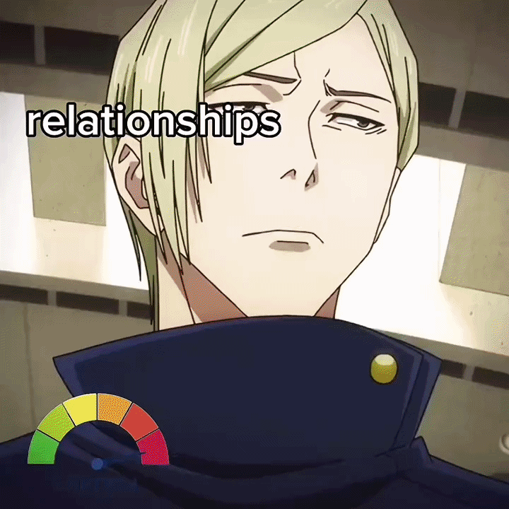

<!-- ЗАМЕНИ: USERNAME, ИМЯ, ссылки и тексты. Гифки лежат рядом с README в репозитории. -->

  

  

  
  
  

<h3 align="center">🚧 ✨ <u>~*~ ЛИЧНАЯ СТРАНИЧКА ~*~</u> ✨ 🚧</h3>

---

## 🧠 Что это такое

Моя личная страница. Тут всё как в 2003-м: гифки, счётчик посетителей и гостевая книга. Только ещё и полезная — ниже есть нормальная инфа обо мне и моих проектах.

> [!WARNING]
> Страница содержит повышенное количество гифок. Если у тебя слабый интернет — это не мои проблемы.

> [!NOTE]
> Если ты ищешь серьёзную информацию, она находится в разделах **«Проекты»**, **«Стек»** и **«FAQ»**. Всё остальное — шум для атмосферы.

---

## 📦 Проекты

| Проект | Что делает | Статус |
|:--|:--|:-:|
| [**название-проекта-1**](https://github.com/USERNAME/repo1) | Одна строка про то, что это | ✅ работает |
| [**название-проекта-2**](https://github.com/USERNAME/repo2) | Одна строка про то, что это | 🛠 в процессе |
| [**название-проекта-3**](https://github.com/USERNAME/repo3) | Одна строка про то, что это | 💀 заброшен |

---

## 🛠 Стек

  
  
  
  

Остальное гуглю по ходу дела, как и все.

---

## 📥 Скачать

  

(на самом деле это просто ссылка на мои репозитории, вирусов нет)

---

## ❓ FAQ

<b>Почему тут столько гифок?</b>

 
Потому что один контент на экране — это скучно. Мозг должен получать всё сразу.

<b>Это вообще для чего?</b>

 
Чтобы показать проекты и немного повеселиться. Первое — серьёзно, второе — тоже серьёзно.

<b>Как с тобой связаться?</b>

 

- Telegram: [@username](https://t.me/username)
- Почта: `you@example.com`
- Или оставь запись в гостевой книге ниже ⬇️

<b>Можно ли использовать твой код?</b>

 
Да, если не сломаешь. Если сломаешь — это уже твой код.

---

## 📖 Гостевая книга

Оставь сообщение в [**Issues**](https://github.com/USERNAME/USERNAME/issues/new) — как в старые добрые времена. Тема: «Был тут».

---

  
  
  
  

© 2026 · сделано на коленке · последнее обновление: когда-нибудь

  

